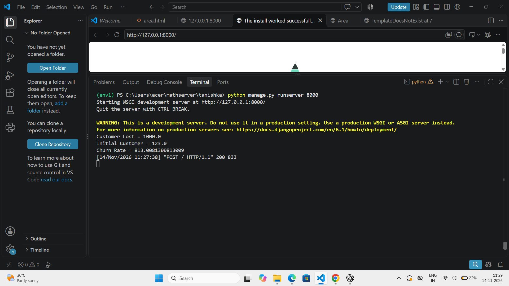
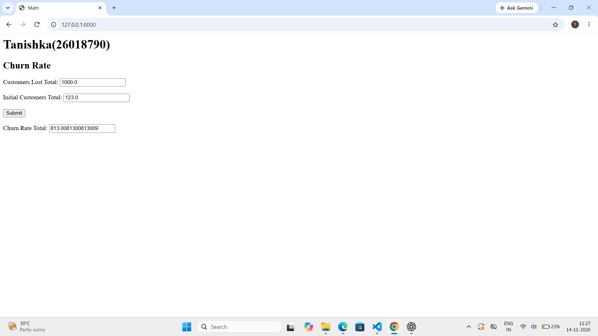

# Ex.03 Design a Website for Server Side Processing
## Date: 14.11.2026

## AIM:
To create a web page to calculate Churn Rate using server-side scripts.

## FORMULA:
Churn Rate = (CustLost / InitCust) * 100
<br> InitCust --> Initial Customers Count
<br> CustLost --> Customers Lost Count

## DESIGN STEPS:

### Step 1:
Clone the repository from GitHub.

### Step 2:
Create Django Admin project.

### Step 3:
Create a New App under the Django Admin project.

### Step 4:
Create a HTML file to implement form based input and output.

### Step 5:
Create python programs for views and urls to perform server side processing.

### Step 6:
Receive input values from the form using request.POST.get().

### Step 7:
Calculate the Result using the given formula.

### Step 8:
Display the calculated result in the server console.

### Step 9:
Render the result to the HTML template.

### Step 10:
Publish the website in Localhost.

## PROGRAM:

```
<html>
    <head>
        <title>Math</title>
    </head>
    <body>
        <h1>Tanishka(26018790)</h1>
        <h2>Churn Rate</h2>

        <form method="POST">
            
            
            <label>Customers Lost Total:</label>
            <input type="number" value="{{ Customers_Lost }}" name="CustLost">
            <br><br>
            
            <label>Initial Customers Total:</label>
            <input type="number" value="{{ Initial_Customer }}" name="InitCust">
            <br><br>
            
            <button type="submit">Submit</button>
            <br><br>
            
            <label>Churn Rate Total:</label>
            <input type="number" value="{{ Churn_Rate }}">
        </form>
    </body>
</html>


views.py
from django.shortcuts import render

def churncalculator(request):
    Customers_Lost = float(request.POST.get('CustLost', '0'))
    Initial_Customer = float(request.POST.get('InitCust', '0'))

    Churn_Rate = ( Customers_Lost / Initial_Customer) * 100 if request.method == 'POST' else 0

    print("Customer Lost =", Customers_Lost)
    print("Initial Customer =", Initial_Customer)
    print("Churn Rate =", Churn_Rate)

    return render(
        request,
        'myapp/hi.html',
        {
            'Customers_Lost': Customers_Lost, 
            'Initial_Customer': Initial_Customer, 
            'Churn_Rate': Churn_Rate
        }
    )


urls.py
from django.contrib import admin
from django.urls import path
from myapp import views

urlpatterns = [
    path('', views.churncalculator, name='churncalculator'),
]

```

## OUTPUT - SERVER SIDE:



## OUTPUT - WEBPAGE:



## RESULT:
The the web page to calculate Churn Rate using server-side scripts is created successfully.
